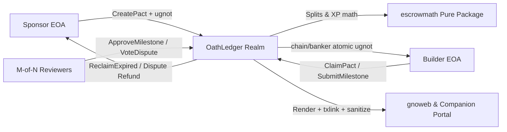

# OathLedger — Trustless Milestone Escrow & Proof-of-Contribution Protocol on Gno.land

> Built for the **DoraHacks Gnome Tavern Hackathon (Gno.land)**
>
> Pure Gno (`v1.8.0`) smart contracts with native `chain/banker` `ugnot` escrow, M-of-N peer-reviewer quorums, zero-admin dispute arbitration, multi-route `gnoweb` rendering (`p/moul/txlink/v0` + `p/nt/markdown/sanitize/v0`), and a live `vm/qrender` companion web portal.

---

## Why OathLedger?

Open-source grant programs, DAO bounties, and ecosystem hackathons suffer from two recurring failure modes:
1. **Unilateral custodian risk** — sponsors or multisigs hold funds off-chain and delay payouts.
2. **Ephemeral builder reputation** — contributors ship verified code across projects, yet have no permanent, tamper-proof on-chain work history.

**OathLedger** solves both natively on **Gno.land**:
- **Deterministic Multi-Milestone Escrow (`p/.../escrowmath`)**: Splits locked `ugnot` across up to 10 milestones in basis points (`10,000 bps = 100%`) with strict zero-dust integer conservation (`sum(amounts) == totalUgnot`).
- **M-of-N Peer-Reviewer Quorum Releases (`r/.../oathledger`)**: Sponsors lock native `ugnot` via `CreatePact` (guarded by `cur.Previous().IsUserCall()` to prevent `unsafe.OriginSend()` phantom-payment attacks). Builders claim pacts and submit verifiable proof URIs per milestone; the instant M-of-N reviewers call `ApproveMilestone`, `chain/banker` atomically sends `ugnot` directly to the builder.
- **Zero-Admin Trustless Dispute Arbitration**: Either party can freeze a pact via `RaiseDispute`; the designated reviewer quorum settles remaining funds via `VoteDisputeResolution(pactID, builderShareBps)` with zero privileged contract admin.
- **Deadline Auto-Refunds**: Unpaid `ugnot` can be safely reclaimed by the sponsor via `ReclaimExpired` once the deadline passes.
- **Immutable Proof-of-Contribution (PoC) Ledger**: Every approved milestone permanently awards deterministic PoC XP (`Apprentice` → `Craftsman` → `Master` → `Legend`), rendered natively as verifiable builder resumes on `gnoweb`.
- **Sanitized Multi-Route `gnoweb` UI**:
  - `/` — Protocol telemetry, active locked `ugnot`, and pacts table with deterministic progress bars
  - `/pact/<id>` — Full milestone ledger + one-click `p/moul/txlink/v0` actions (`ClaimPact`, `SubmitMilestone`, `ApproveMilestone`)
  - `/builder/<addr>` — Verifiable on-chain Proof-of-Contribution resume
  - `/leaderboard` — AVL-indexed builder rankings

---

## Architecture



---

## Packages & Realms (Gno.land `onyx-1` Namespace)

| Component | Module Path | Live `onyx-1` Link |
| --- | --- | --- |
| **Pure Math Package** | `gno.land/p/g1ty0rp975ndkcse760v0zt659f4phs4z8lueud7/escrowmath` | [View Package on gnoweb](https://onyx.testnets.gno.land/p/g1ty0rp975ndkcse760v0zt659f4phs4z8lueud7/escrowmath) |
| **Stateful Realm** | `gno.land/r/g1ty0rp975ndkcse760v0zt659f4phs4z8lueud7/oathledger` | [Live Realm on gnoweb](https://onyx.testnets.gno.land/r/g1ty0rp975ndkcse760v0zt659f4phs4z8lueud7/oathledger) |
| **Companion Portal** | `frontend/` (React + Vite) | Live `onyx-1` RPC + `vm/qrender` viewer & interactive milestone quorum simulator |

### Live `onyx-1` On-Chain Proof (Verified End-to-End Lifecycle)

All contract deployment and multi-account lifecycle transactions are live and verifiable on `onyx-1`:
- **Live Gnoweb Home**: `https://onyx.testnets.gno.land/r/g1ty0rp975ndkcse760v0zt659f4phs4z8lueud7/oathledger`
- **Live PoC Leaderboard**: `https://onyx.testnets.gno.land/r/g1ty0rp975ndkcse760v0zt659f4phs4z8lueud7/oathledger:leaderboard`
- **On-Chain Telemetry**: `3` Total Pacts (`#1 COMPLETED`, `#2 ACTIVE` with Milestone 0 submitted, `#3 OPEN`), **`4.500000 GNOT`** active escrow locked, **`2.500000 GNOT`** atomically released to builder `g1kvv3gap7vu73e3w8l9lvaj0l2pz3pv43gmnxzz` (`370` PoC XP, `Apprentice` tier).

| Step | Action | Block Height | Tx Hash (`onyx-1`) |
| --- | --- | --- | --- |
| Deploy Package | `addpkg` `escrowmath` | `#1415366` | `ssgayq33XaRNaK0sUOjgQ+javKcJ5O5Y8bD67I6C4ZU=` |
| Deploy Realm | `addpkg` `oathledger` | `#1415367` | `0dueOtU3FhjvZ9GRFObDjBT8a1lWPSwi8qJ3/0iq/fI=` |
| Pact #1 Created | `CreatePact` (`2.5 GNOT`, 40/60 split) | `#1423833` | `8hzjz5kh8+jdKLDfYi8QIsBb0FYvLX26CFwWKmQcmBQ=` |
| Pact #1 Claimed | `ClaimPact(1)` by builder | `#1423834` | `6xjHDs41iDN816ak0+TtX/fV5iLxLGXY0H7pgTndnFE=` |
| Pact #1 M0 Proof | `SubmitMilestone(1, 0)` | `#1423836` | `9YIDN5/xNouUIrC9c4Cd0ZZZ+oeK6gQ/4PncqO2tbhA=` |
| Pact #1 M0 Release | `ApproveMilestone(1, 0)` → `1.0 GNOT` paid | `#1423838` | `J2aD5p/1SbPNWqnx0Crp4UckZl+FI4K3OIPQK+6+6aQ=` |
| Pact #1 M1 Proof | `SubmitMilestone(1, 1)` | `#1423839` | `qXEP5o+1JNPTHiOfLsWj7/usAD/XW4YO7/KJ1yi2Trw=` |
| Pact #1 M1 Release | `ApproveMilestone(1, 1)` → `1.5 GNOT` paid (`COMPLETED`) | `#1423840` | `KiEdH51t1s1cyzgFLC3yHSh0CX1O6ddYpuvPPEFoa7Y=` |
| Pact #2 Active | `CreatePact(3.0 GNOT)` + `ClaimPact(2)` + `SubmitMilestone(2, 0)` | `#1423841`–`#1423844` | `QQtpj5b9z4wXQOfu0n3roocMGdTKKuXXEtyNk/LSwBQ=` |
| Pact #3 Open | `CreatePact(1.5 GNOT)` (`OPEN`) | `#1423845` | `ADPanKAcSxBt7feFbkvpi+kQc+ZjAOgYDpx65vpB1r0=` |

---

## Quick Start & Reproducibility

### 1. Run Gno VM Unit & Integration Tests
All **7 Gno VM tests** (`4` in `escrowmath` + `3` end-to-end banker/quorum/dispute/expiry tests in `oathledger`) run directly on `gnolang/gno v1.8.0`:

```bash
# Using gno CLI (from a gno workspace with examples/)
gno test -v ./gno.land/p/g1ty0rp975ndkcse760v0zt659f4phs4z8lueud7/escrowmath ./gno.land/r/g1ty0rp975ndkcse760v0zt659f4phs4z8lueud7/oathledger
```

### 2. Deploy Live to Gno.land `onyx-1` Testnet
```powershell
# 1. Fund deployer address g1ty0rp975ndkcse760v0zt659f4phs4z8lueud7 at https://faucet.gno.land/
# 2. Run one-click deploy & seed script:
.\scripts\deploy-onyx.ps1
```

### 3. Launch Companion Web Portal
```bash
cd frontend
npm install
npm run dev
```

---

## Security Highlights
- **EOA User-Call Enforcement**: `CreatePact` rejects non-user calls (`!cur.Previous().IsUserCall()`) so `unsafe.OriginSend()` can never be abused by ephemeral/intermediate realms to drain pre-existing escrow balances.
- **Checks-Effects-Interactions**: State transitions (`MilestonePaid`, `StatusResolved`, `StatusExpired`, `activeLockedUgnot`) are committed before every `banker.SendCoins` call.
- **Anti-Self-Farming**: Sponsors are prohibited from claiming their own pacts to inflate PoC XP.
- **Markdown Injection Protection**: All user-supplied titles, summaries, proof URIs, and dispute reasons are sanitized with `gno.land/p/nt/markdown/sanitize/v0`.
